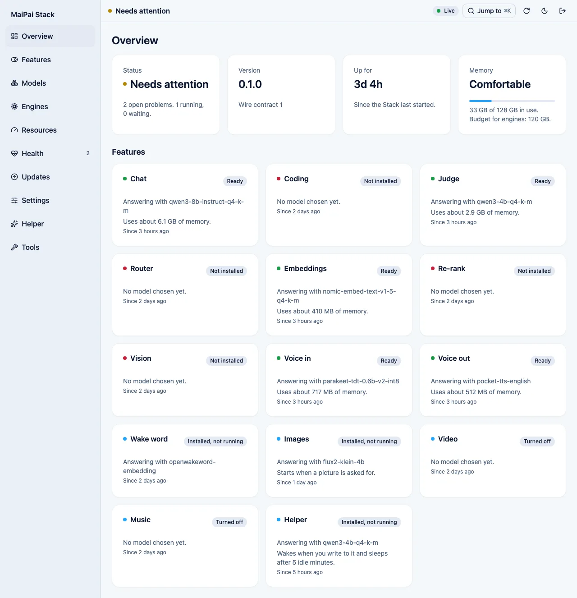

<p align="center">
  <picture>
    <source media="(prefers-color-scheme: dark)" srcset="https://raw.githubusercontent.com/getmaipai/.github/main/brand/maipai-stack-logo-dark.png">
    
  </picture>
</p>

**The foundation for local AI, at any size.**

# Local AI without the homework

[User docs](docs/user/index.md) · [Install](docs/user/install.md) · [Developer docs](docs/dev.md) · [Connect your apps](docs/integrations.md)

MaiPai Stack is easy to set up, matched to your computer's memory and simple to keep running. One person or many, one model or many: the Stack picks the engine for each job, keeps everything inside your memory, and tells you in plain words when something needs help. Whatever you run on top just works.

It stands on its own, with its own admin page, and it also powers [MaiPai Home](https://github.com/getmaipai/home), the family AI hub. Everything runs on your computer. Nothing is sent anywhere unless you switch on an update check or download a model.

<picture>
  <source media="(prefers-color-scheme: dark)" srcset="docs/images/admin/overview-desktop-dark.webp">
  
</picture>

## The questions every newcomer hits

- **Which models should I use?** Pick your computer's memory size (16, 32, 64 or 128 GB and up). The Stack suggests a setup that fits. Models are a setting you can change, with the size shown before you download.
- **How do I install and run them?** One installer and one admin page. Engines and models are pinned and checked against checksums.
- **How do I tune them?** The ready-made setup for your memory size applies sensible settings from the first minute. Keep your own choices if you prefer.
- **How do I stop them crashing my computer?** A memory guard only loads what fits. You set a priority order, and the work you need most stays loaded.
- **How do I run one job without slowing another?** Chat, voice and the wake word stay loaded. A picture, video or music job waits in a queue, or is refused with a reason, when memory is short.
- **Where are the logs, and why did it break?** Health lists each problem in plain words with one fix button, and recent engine log lines sit on the Engines screen.
- **Can I just ask?** A built-in Helper answers questions about your setup. It shows a card and asks before it changes anything.
- **How do I connect my other apps?** The Stack speaks the OpenAI format on one local address, so a client built for that API works unchanged. See [docs/integrations.md](docs/integrations.md).
- **How do I update safely?** Update an engine and go back if the new one misbehaves. The Stack itself rolls back too.

## Getting started

About 10 minutes on a Mac with Apple Silicon. You need [Bun](https://bun.sh) installed.

No release has been published yet, so you build one first. From a checkout of this repo (the build needs sibling checkouts of `getmaipai/commons` and `getmaipai/.github`, see [docs/dev/installer.md](docs/dev/installer.md)):

```
bash scripts/release-stack.sh v0.1.0
```

That writes the release files to `release/`. The install steps, and how to install from a published release once there is one, are in [docs/user/install.md](docs/user/install.md). After install, open `http://127.0.0.1:8770/admin/` and enter the one-time setup code that the installer points you to.

> The Stack listens on your own computer only. The admin page needs a password. Reaching it from another device is off unless you turn on the Tailscale option in Settings.

## Status

MaiPai Stack is pre-1.0. Home runs on it every day, so the engines work. The standalone install and the admin page are new: macOS on Apple Silicon is tested, Linux is not, Windows is not supported. Tell us what you find.

## Documentation

- [User docs](docs/user/index.md): install, sign in, choose features and models, update, fix a problem, privacy.
- [Developer docs](docs/dev.md): the design record, plus the [admin API](docs/dev/admin-api.md), the [Helper](docs/dev/helper.md) and the [installer](docs/dev/installer.md).
- [Integration contract](docs/integrations.md) for Home and Bot, and [what is pinned today](docs/components.md).
- Found a bug? Open an issue on this repo.

## Development

This repo is one Bun daemon (`backend/`) and the admin page (`admin-ui/`). `scripts/check.sh` is the gate and needs sibling checkouts of `getmaipai/.github` and `getmaipai/commons`. `bash scripts/make-admin-screenshots.sh` regenerates the screenshots in `docs/images/admin/`. Standards live in [getmaipai/.github](https://github.com/getmaipai/.github).

---

MaiPai is open-source software for personal, self-hosted, non-commercial
use by you and your household. It is not affiliated with, endorsed by, or
sponsored by any platform it can connect to. All product names and
trademarks belong to their respective owners. You are responsible for
complying with the terms and laws that apply to you and the services you
access.

The models the Stack downloads are made by third parties and chosen by
you. What they produce can be wrong, offensive, or harmful, and is not
medical, legal, or professional advice. You are responsible for how you
use it.

Licensed under [AGPL-3.0](LICENSE).
