# A tour of the admin page

The admin page has ten screens. Pick one from the list on the left, or on a phone from the bar at the bottom. Press `Command` and `K` to jump to any screen by name.

The bar at the top shows the Stack's state in a few words ("Everything is running" or "Needs attention") and whether the page is getting live updates. The moon and sun button switches light and dark.

## Sign in

<picture>
  <source media="(prefers-color-scheme: dark)" srcset="../images/admin/sign-in-desktop-dark.webp">
  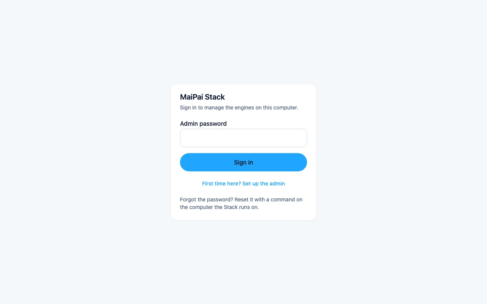
</picture>

One password, set the first time you open the page. See [Sign in for the first time](sign-in.md).

## Overview

<picture>
  <source media="(prefers-color-scheme: dark)" srcset="../images/admin/overview-desktop-dark.webp">
  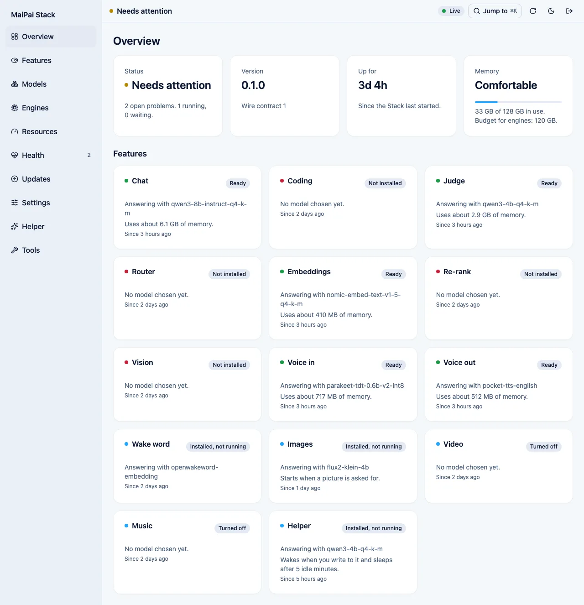
</picture>

The big picture: status, version, how long the Stack has been up, how much memory is in use, and one card per feature. Each card says which model is answering.

## Features

<picture>
  <source media="(prefers-color-scheme: dark)" srcset="../images/admin/features-desktop-dark.webp">
  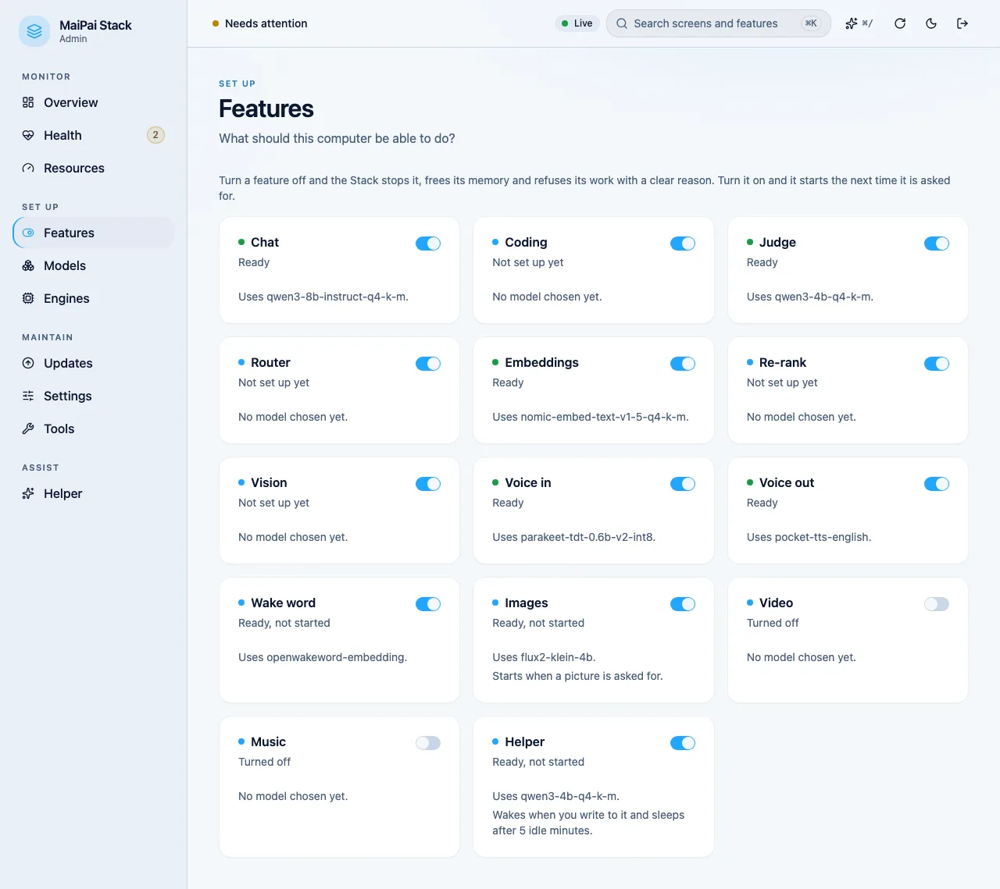
</picture>

A switch for each feature. Off means the Stack stops it, frees its memory, and says why it refuses that work. See [Choose features and models](features-and-models.md).

## Models

<picture>
  <source media="(prefers-color-scheme: dark)" srcset="../images/admin/models-desktop-dark.webp">
  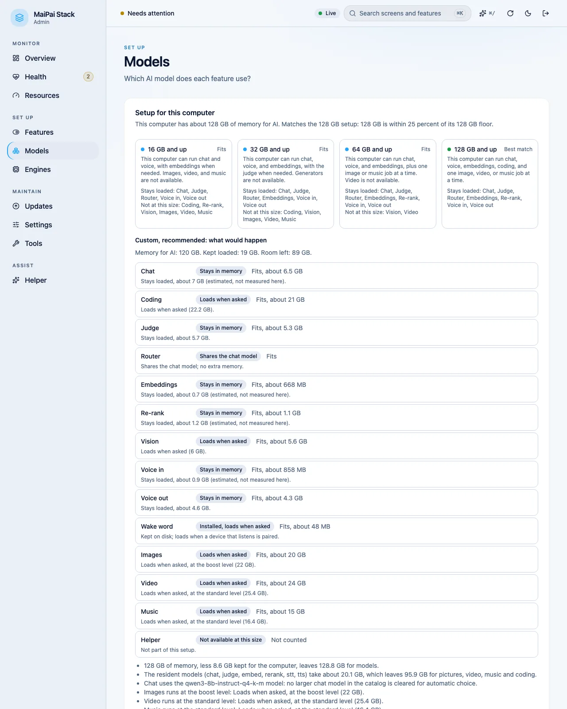
</picture>

The setup for your computer, the order features win memory, and the models you can download or remove.

## Resources

<picture>
  <source media="(prefers-color-scheme: dark)" srcset="../images/admin/resources-desktop-dark.webp">
  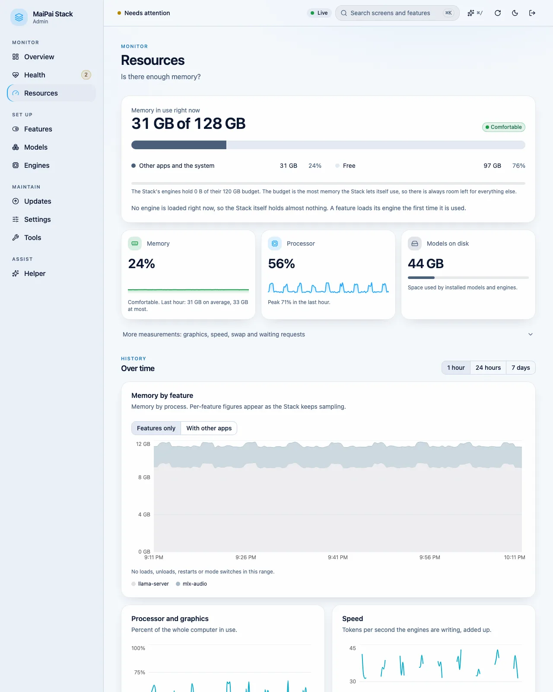
</picture>

A live bar of memory split by engine, then CPU, swap, waiting requests and disk used by models. Charts below show the last hour, 24 hours or 7 days. A number marked "Comfortable" means plenty of room. "Getting tight" means the Stack is starting to hold work back.

## Engines

<picture>
  <source media="(prefers-color-scheme: dark)" srcset="../images/admin/engines-desktop-dark.webp">
  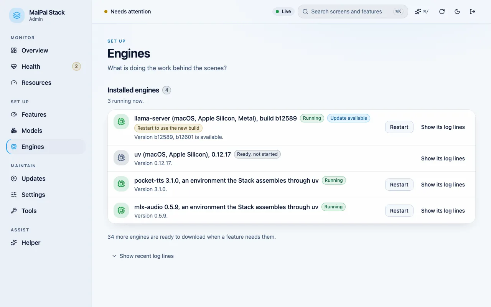
</picture>

Each installed engine with its version and a **Restart** button. The recent log lines are at the bottom, with secrets removed.

## Health

<picture>
  <source media="(prefers-color-scheme: dark)" srcset="../images/admin/health-desktop-dark.webp">
  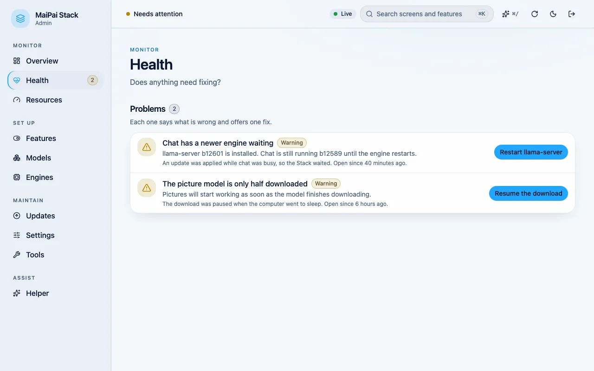
</picture>

A short list of problems. Each one says what is wrong, why, and has one button to fix it. An empty list reads "No problems".

## Updates

<picture>
  <source media="(prefers-color-scheme: dark)" srcset="../images/admin/updates-desktop-dark.webp">
  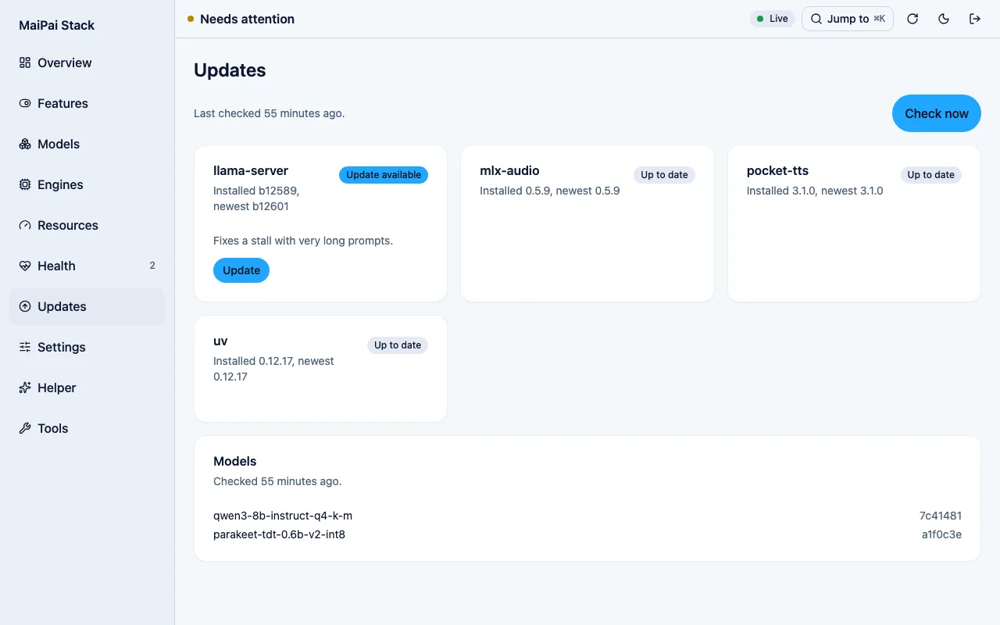
</picture>

Installed and newest versions, **Check now**, **Update**, and **Go back**. See [Update, and go back](update-and-go-back.md).

## Settings

<picture>
  <source media="(prefers-color-scheme: dark)" srcset="../images/admin/settings-desktop-dark.webp">
  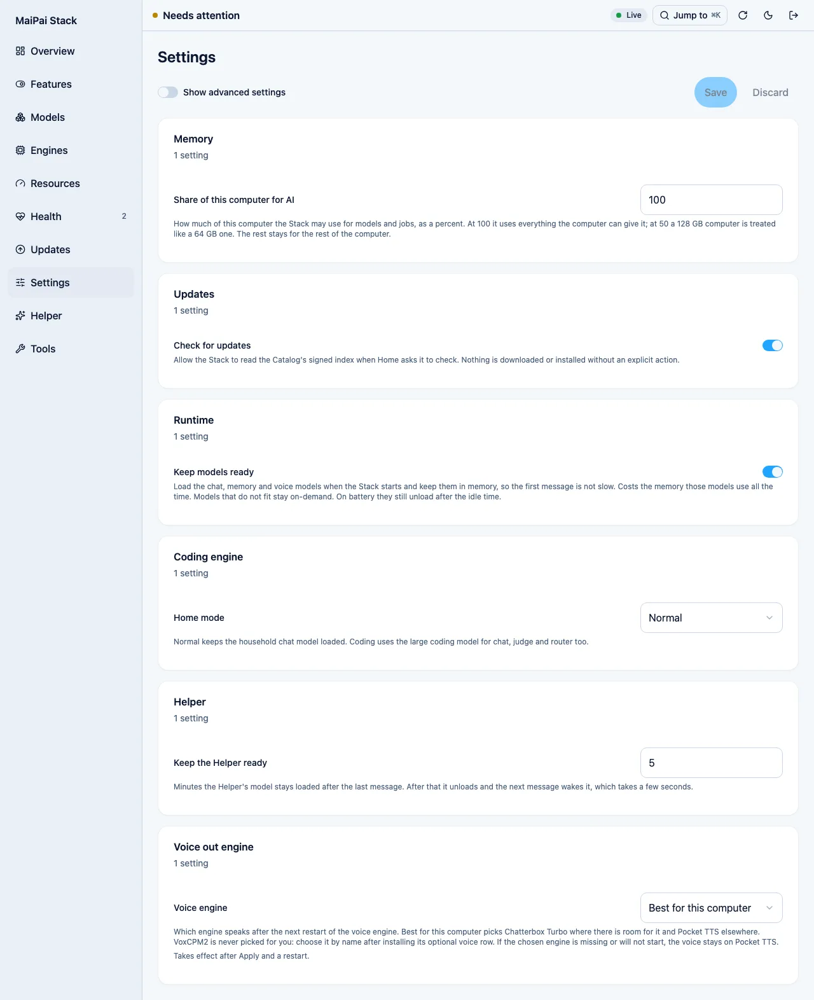
</picture>

Every setting the Stack declares, grouped, with a plain sentence under each. Change what you want, click **Save**. Some changes say they need a restart. Switch on **Show advanced settings** to see more.

## Helper

<picture>
  <source media="(prefers-color-scheme: dark)" srcset="../images/admin/helper-desktop-dark.webp">
  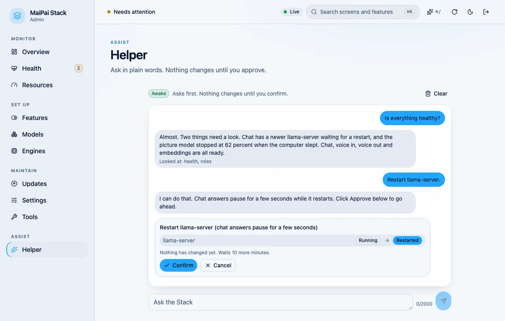
</picture>

A chat box for questions about this computer. See [Ask the Helper a question](helper.md).

## Tools

<picture>
  <source media="(prefers-color-scheme: dark)" srcset="../images/admin/tools-desktop-dark.webp">
  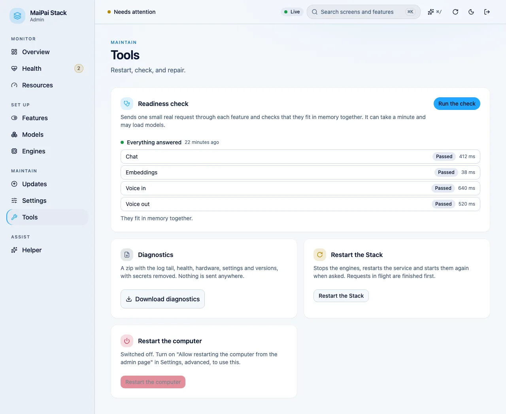
</picture>

A readiness check (one small real request through each feature), a diagnostics download, **Restart the Stack**, and **Restart the computer**. The last one is switched off until you turn on "Allow restarting the computer from the admin page" in Settings.

## On a phone

Every screen fits a 375 pixel wide phone. The page works in light and dark. You reach it from a phone only through Tailscale, as described in [Sign in for the first time](sign-in.md).

## Still need help?

Read [If something is not working](fix-a-problem.md).
